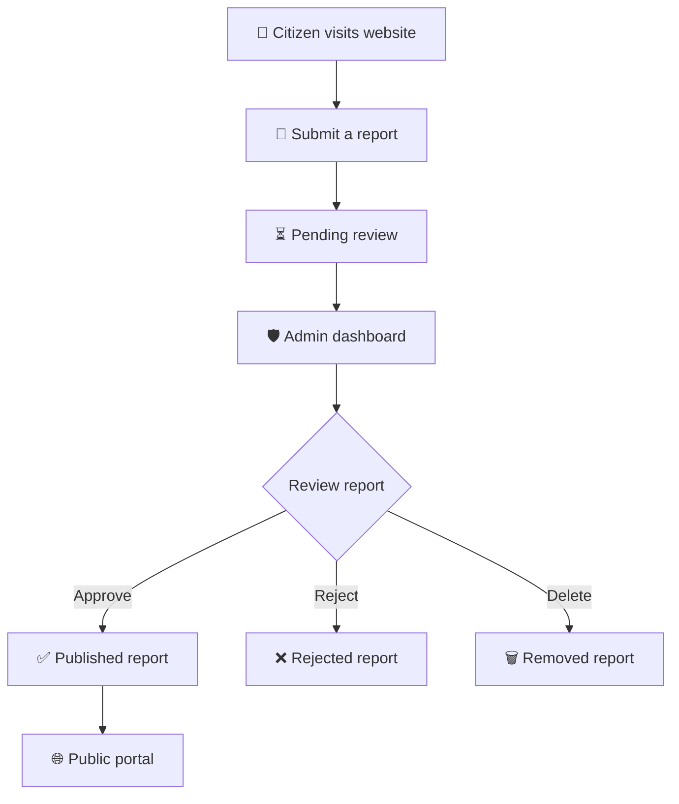

# 🇧🇩 নাগরিক লেজার

### নাগরিক সেবার ডিজিটাল খাতা

<p align="center">
  
  
  
  
</p>

<p align="center">
  <strong>সমস্যা থেকে সমাধানের পথে, প্রতিটি নাগরিক কণ্ঠস্বর গুরুত্বপূর্ণ।</strong>
</p>

<p align="center">
  একটি আধুনিক বাংলা-কেন্দ্রিক Civic Reporting Web Application, যেখানে নাগরিকরা সমস্যা রিপোর্ট করতে পারেন এবং অ্যাডমিন সেই রিপোর্টগুলো পর্যালোচনা ও পরিচালনা করতে পারেন।
</p>

---

## ✦ About The Project

**নাগরিক লেজার (Nagorik Ledger)** একটি নাগরিক রিপোর্টিং ও তথ্য ব্যবস্থাপনা ওয়েব প্রজেক্ট। এর লক্ষ্য নাগরিক সমস্যার রিপোর্ট ডিজিটালভাবে নথিভুক্ত করা, অনুমোদিত রিপোর্ট প্রকাশ করা এবং রিপোর্ট পরিচালনার প্রক্রিয়াকে আরও সহজ ও স্বচ্ছ করে তোলা।

প্রজেক্টটি তৈরি করা হয়েছে **HTML5, CSS3 এবং Vanilla JavaScript** ব্যবহার করে। কোনো React, Vue, Angular বা build tool বাধ্যতামূলক নয়।

> **Our Vision:** ডিজিটাল প্রযুক্তির মাধ্যমে নাগরিক অংশগ্রহণ, স্বচ্ছতা এবং জবাবদিহিতার একটি সহজ অভিজ্ঞতা তৈরি করা।

## ✨ Key Features

<table>
  <tr>
    <td width="50%">
      <h3>📝 Citizen Reporting</h3>
      নাগরিক সমস্যার রিপোর্ট জমা দেওয়ার ইন্টারফেস।
    </td>
    <td width="50%">
      <h3>🔐 Admin Authentication</h3>
      ডেমো অ্যাডমিন লগইন ও সেশন পরিচালনা।
    </td>
  </tr>
  <tr>
    <td>
      <h3>✅ Report Moderation</h3>
      রিপোর্ট অনুমোদন, বাতিল এবং মুছে ফেলার সুবিধা।
    </td>
    <td>
      <h3>📊 Dashboard Analytics</h3>
      রিপোর্টের পরিসংখ্যান ও চার্ট।
    </td>
  </tr>
  <tr>
    <td>
      <h3>🇧🇩 Bangla-First UI</h3>
      বাংলা ভাষাভিত্তিক ব্যবহারবান্ধব ইন্টারফেস।
    </td>
    <td>
      <h3>📱 Responsive Design</h3>
      বিভিন্ন স্ক্রিন সাইজে ব্যবহারের উপযোগী ডিজাইন।
    </td>
  </tr>
</table>

## 🧰 Technology Stack

<p>
  
  
  
  
</p>

| Technology         | Usage                                      |
| ------------------ | ------------------------------------------ |
| HTML5              | Semantic page structure                    |
| CSS3               | Styling, layouts and animations            |
| Vanilla JavaScript | Application logic and interactions         |
| LocalStorage       | Browser-side report persistence            |
| SessionStorage     | Demo session state                         |
| Web Crypto API     | SHA-256 demo hash calculation/verification |

## 🗺️ Application Pages

| Page               | Path                   | Purpose                     |
| ------------------ | ---------------------- | --------------------------- |
| 🏠 Public Portal   | `index.html`           | পাবলিক রিপোর্ট ও পরিসংখ্যান |
| 🔑 Admin Login     | `admin/login.html`     | অ্যাডমিন লগইন               |
| 📊 Admin Dashboard | `admin/dashboard.html` | রিপোর্ট ব্যবস্থাপনা         |

## 🔄 How It Works



### Report Status

* 🟡 **Pending:** অ্যাডমিনের পর্যালোচনার অপেক্ষায়।
* 🟢 **Approved:** অনুমোদিত রিপোর্ট, যা পাবলিক সাইটে দেখানো যায়।
* 🔴 **Rejected:** অ্যাডমিন কর্তৃক বাতিল করা রিপোর্ট।

## 🚀 Quick Start

### Requirements

* আধুনিক ওয়েব ব্রাউজার
* Node.js অথবা Python 3 (ঐচ্ছিক, লোকাল সার্ভারের জন্য)

### 1. Clone the Repository

```bash
git clone https://github.com/YOUR_USERNAME/nagorik-ledger.git
```

### 2. Enter the Project Directory

```bash
cd nagorik-ledger
```

### 3. Start the Website

**Option A — Direct Browser**

`index.html` ফাইলটি ব্রাউজারে খুলুন।

**Option B — Node.js**

```bash
npx serve .
```

**Option C — Python**

```bash
python -m http.server 8000
```

তারপর ভিজিট করুন:

```text
http://localhost:8000
```

> `YOUR_USERNAME`-এর পরিবর্তে আপনার GitHub username এবং repository URL বসান।

## 🔑 Demo Admin Login

| Credential | Value        |
| ---------- | ------------ |
| Username   | `admin`      |
| Password   | `Admin@2026` |

**⚠️ Demo credentials only. Never use these credentials on a production server.**

### Password Hash Configuration

ডেমো authentication-এর পাসওয়ার্ড হ্যাশ `js/auth.js`-এর `HASH` কনফিগারেশনে রাখা হয়েছে।

Hash input format:

```text
nagorik-ledger::<password>
```

নতুন পাসওয়ার্ডের SHA-256 hash তৈরি করে বর্তমান কোডের প্রত্যাশিত ফরম্যাট অনুযায়ী `HASH` আপডেট করুন।

মনে রাখবেন, ক্লায়েন্ট-সাইড হ্যাশ ও লগইন বাস্তব নিরাপত্তা নিশ্চিত করে না। প্রোডাকশনে সার্ভার-সাইড authentication প্রয়োজন।

## 📂 Project Structure

```text
nagorik-ledger/
│
├── index.html
│
├── admin/
│   ├── login.html
│   └── dashboard.html
│
├── css/
│   ├── base.css
│   ├── site.css
│   └── admin.css
│
├── js/
│   ├── store.js
│   ├── ui.js
│   ├── auth.js
│   ├── main.js
│   ├── login.js
│   └── admin.js
│
├── assets/
│   └── favicon.svg
│
├── robots.txt
└── README.md
```

## 🎨 Design Principles

* **Bangla First:** বাংলা ভাষায় সহজ ও পরিষ্কার অভিজ্ঞতা।
* **Simple Navigation:** গুরুত্বপূর্ণ পেজ সহজে খুঁজে পাওয়া।
* **Visual Clarity:** রিপোর্টের অবস্থা দ্রুত শনাক্ত করা।
* **Responsive Layout:** ডেস্কটপ ও ছোট স্ক্রিনে ব্যবহারযোগ্য ইন্টারফেস।
* **Lightweight Architecture:** কোনো বাধ্যতামূলক frontend framework নেই।

## 🔒 Security & Limitations

নাগরিক লেজারের বর্তমান সংস্করণ একটি **frontend prototype**, production-ready civic service নয়।

* ব্রাউজার-ভিত্তিক ডেটা সব ব্যবহারকারীর মধ্যে শেয়ার হয় না।
* LocalStorage-এর তথ্য ব্যবহারকারী পরিবর্তন বা মুছে ফেলতে পারেন।
* Client-side authentication নিরাপদ server-side authorization-এর বিকল্প নয়।
* ডেমো সংস্করণে কেন্দ্রীয় ডেটাবেস ও audit logging নেই।
* ব্যক্তিগত বা সংবেদনশীল নাগরিক তথ্য বাস্তব ব্যবহারের জন্য এই সংস্করণে জমা দেওয়া উচিত নয়।

### Recommended Production Upgrades

* [ ] Node.js + Express / Django / Laravel backend
* [ ] PostgreSQL / MySQL database
* [ ] Secure server-side authentication
* [ ] Role-based access control
* [ ] Input validation and rate limiting
* [ ] HTTPS and secure session cookies
* [ ] Admin activity and audit logs
* [ ] Database backup and recovery
* [ ] Privacy policy and data protection
* [ ] Automated tests and deployment pipeline

## 🛣️ Future Roadmap

* [ ] Citizen accounts and report tracking IDs
* [ ] Category-based report filtering
* [ ] Search and pagination
* [ ] Location-based civic reporting
* [ ] Secure image attachments
* [ ] Email/SMS notifications
* [ ] Advanced dashboard analytics
* [ ] Accessibility improvements
* [ ] Progressive Web App support
* [ ] Backend and database integration

## 🤝 Contributing

আপনার পরামর্শ, bug report এবং feature request স্বাগত।

1. Repository fork করুন।
2. একটি feature branch তৈরি করুন।
3. আপনার পরিবর্তনগুলো করুন।
4. পরিবর্তনগুলো পরীক্ষা করুন।
5. Pull Request জমা দিন।

```bash
git checkout -b feature/your-feature
git add .
git commit -m "Add: describe your changes"
git push origin feature/your-feature
```

Bug বা feature request-এর জন্য GitHub Issues ব্যবহার করুন।

## 📜 License

প্রজেক্টে আলাদা `LICENSE` ফাইল যোগ না করা থাকলে নির্দিষ্ট কোনো open-source license প্রযোজ্য বলে ধরে নেওয়া যাবে না। বিতরণ বা পুনর্ব্যবহারের আগে উপযুক্ত লাইসেন্স নির্বাচন করুন।

## 👨‍💻 Developer

<p align="center">
  <strong>MD ATIQUL ISLAM (Atik)</strong><br/>
  Software Developer
</p>

<p align="center">
  📧 <a href="mailto:atik.cmttiu1001@gmail.com">atik.cmttiu1001@gmail.com</a><br/>
  🐙 <a href="https://github.com/ATIQULTIU">GitHub Profile</a><br/>
  🌐 <a href="https://md-atiqul-islam.my.canva.site/">Portfolio Website</a>
</p>

---

<p align="center">
  <strong>🇧🇩 নাগরিক লেজার — নাগরিক কণ্ঠস্বর, ডিজিটাল স্বচ্ছতা।</strong>
</p>

<p align="center">
  <sub>Built with ❤️ using HTML5, CSS3 & Vanilla JavaScript.</sub>
</p>
